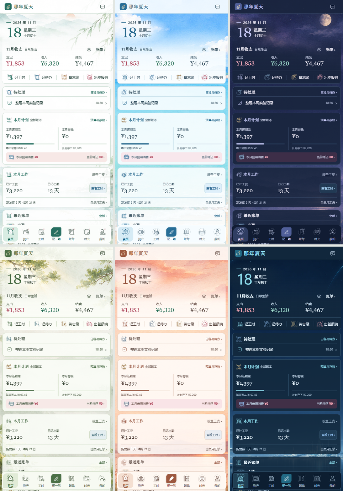

# v3.2 首页全幅插画

2026-11-18 验证。下图采用最终 APK 内的页面和同一组人工样例。上排依次为水墨、海岸、星空，下排为森林、落日、科技。

## 画面与操作

- 主题画按原图比例铺满视口。日期区、收支区和卡片之间共用这张画。竖屏水墨取山、湖和柳枝的全页构图，横屏切到宽幅山水。星空竖屏调整取景位置，使月亮留在画面内。
- 日期与金额下方用渐变托住文字，窄留白和卡片边界仍然可见。浅色场景切到深色模式时降低背景亮度。设置页继续以小图预览所选主题。
- 验证从设置切换六套主题，点手机日期行的右端进入今天、点收支数字进入月报、隐藏和恢复三项金额。滚动、打开更多工具和回到首页均正常。新用例还会在横竖屏检查背景范围及日期内的独立图片。[浏览器回归用例](../tests/browser/home-scene.cjs)。

## 检查结果

| 检查 | 结果 |
| --- | --- |
| 页面适配 | 成品页面在六套主题、320 至 1024px 五种宽度下通过 210 项路由布局检查。六套首页另行检查滚动、配色切换及横竖屏取景。 |
| 首页文字 | 在 320×700、390×844、920×730 三种视口遍历主题、配色与明暗模式的 60 种组合，另查手机横屏、平板竖屏及展开工具后滚到底部的原配主题。210 张背景截图、11,510 个可见文字样本的最低对比度为 4.512∶1。 |
| 回归 | 92 项 Node 测试通过。两个浏览器用例对最终 APK 内的页面通过，涵盖首页铺图点选和旧账编辑。另检查折线、柱状、环图，六套插画离线加载，以及主题配色重新打开后的显示。 |
| 文件 | 七组插画原稿与 WebP 的哈希核对通过。最终 APK 内的 63 个前端文件与工作区逐字节一致。 |

测试使用桌面 Edge 的手机视口。小米真机的系统手势区、设备显示效果和覆盖安装尚待实机验证。

## 安装包

| 项目 | 值 |
| --- | --- |
| 包名 | `com.nianxiatian.app` |
| 版本 | 3.2 / 30200 |
| 最低 / 目标 Android API | 24 / 35 |
| 大小 | 2,762,905 字节，与 v3.1 相同 |
| SHA-256 | `95b7fbd5205f9318ed22a200a8738cd3bff24fa585793ba90210a7b3b4ddcbb3` |
| Git blob | `2055a1862917c73e65c70fafca3451b97c473f97` |
| 原发布证书 SHA-256 | `b08fc9b85314e227d8d97779db460830a7acfeac58e2e3c88fcde9c64ea5827f` |
