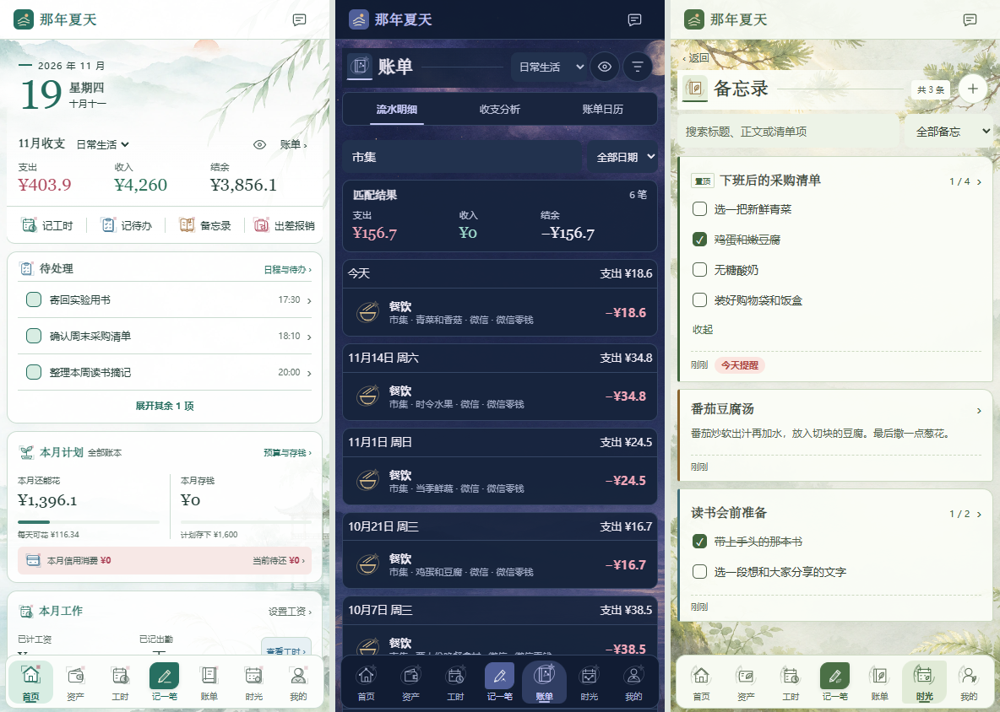

# v3.3 记账、工时和待办检查记录

2026-11-19。下图依次为水墨首页、星空流水、森林备忘录。三页都取自正式签名安装包，账单、工资和清单使用人工样例。

## 日常操作

| 场景 | 核对结果 |
| --- | --- |
| 重复消费 | 用旧账的「再记一笔」修改金额，确认后按今天新增。取消时不写入，原记录保留原日期、账户和金额。归档项目会要求重选。待核对工资、手续费、订阅及报销等关联流水各走原入口。 |
| 找旧账 | 按备注和账户在「全部日期」查找，跨年、切换账本、筛选和继续加载都能用。合计覆盖全部匹配记录；另查转账本金、手续费、出差垫付、报销到账及隐藏金额。 |
| 首页和工资 | 四条以上的待办能展开，当日完成的循环待办可撤销。点明日的日程会选中明日。首页切换账本后收支随之更新，模拟存储写入失败时回到原账本。工资待核对可关联到原收入并选择归属月，账单笔数与金额一致。工时可跳转历史自然月和工资周期，再返回本月／本期。 |
| 采购清单 | 中文输入和移动光标后可继续搜清单项，展开后可勾选。检查了完成提醒取消、刷新后状态保留，以及本地与云备份队列收到新的清单快照。备份验证使用模拟接口。 |
| 应用内 AI | 在未配置 AI Key 的样例上，分别询问怎么再记一笔、跨月查流水、勾选购物清单，均得到对应的操作路径。 |

## 界面与回归

- 92 项 Node 测试、6 个浏览器回归用例通过。浏览器加载成品 APK 的页面，逐字节核对其中全部 65 个前端文件与工作区一致。
- 用 Edge 在六套主题、320 至 1024px 五种宽度上检查 7 个页面，共 210 项布局检查。另从真实入口检查首页、流水和备忘录在 320、390、768px 下的交互和横向溢出，共 54 组。折线、柱状图、分类环图与离线插画均可显示。
- 390×844 视口下，六套首页遍历配色及支持的明暗模式，60 张画面共抽样 3,240 处可见文字，最低对比度为 4.54∶1。流水分日标题另取三种滚动位置，六套主题最低为 9.42∶1。
- 模拟键盘把可用高度缩至 390px，在 320px 与 390px 两种屏宽输入记账备注，输入框和保存按钮均在可见区内。这轮没有连接小米真机，系统键盘、通知送达及手机覆盖安装未经实机验证。

## 安装包

| 项目 | 值 |
| --- | --- |
| 包名 | `com.nianxiatian.app` |
| 版本 | 3.3 / 30300 |
| 最低 / 目标 Android API | 24 / 35 |
| 大小 | 2,771,244 字节 |
| SHA-256 | `4e55fc1e64cf7d65bed7ca9a3cef8e0fcd710005be09d903370361dc305a0fe5` |
| Git blob | `d07e9404744a4e0a4bb32d6e1addc05a8ad7e913` |
| 原发布证书 SHA-256 | `b08fc9b85314e227d8d97779db460830a7acfeac58e2e3c88fcde9c64ea5827f` |
