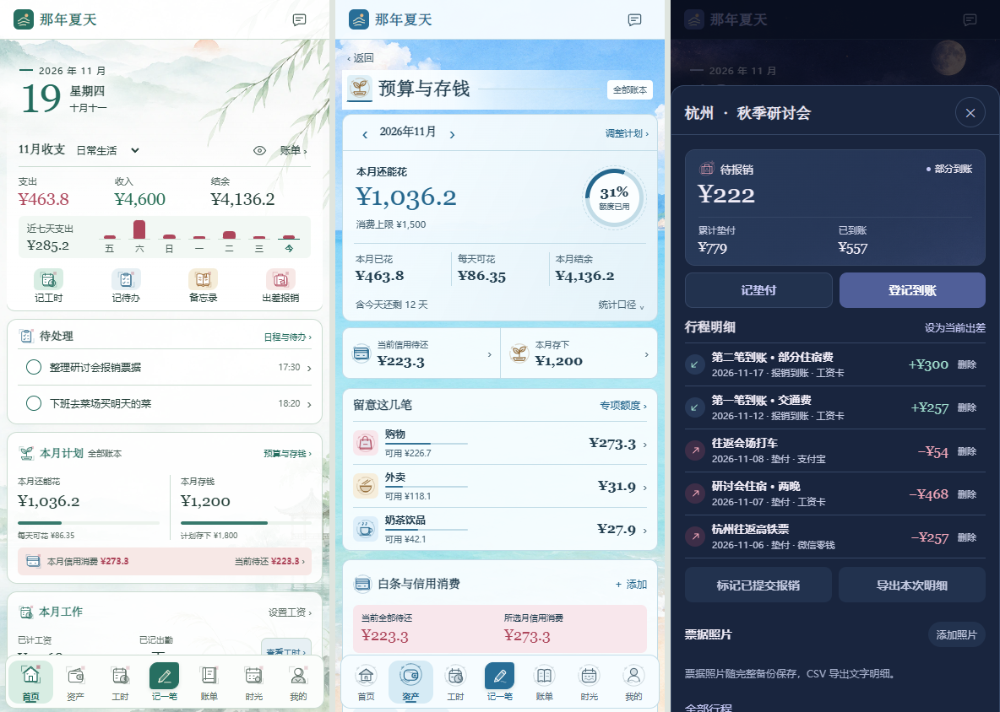

# v3.4 日常记账与界面

2026-11-19。三个画面使用同一份人工样例，依次为水墨首页、海岸预算页和星空出差详情。

## 核对场景

| 入口 | 验证内容 |
| --- | --- |
| 首页 → 近七天支出 | 在 3 月 2 日回看 2 月 28 日的消费。七天合计随账本切换，计入转账手续费，排除转账本金和出差垫付。点柱子进入当天账单，补记沿用所点日期。金额隐藏时，柱高、数字与读屏说明均遮住金额。 |
| 预算与存钱 | 在月报上点当前信用待还或本月存款，可跳到对应记录。检查无预算、大幅超支和长金额，键盘可以展开统计口径。预算使用率隐藏后同步隐藏图形。 |
| 白条 → 记消费／记还款 | 已经开始出差时，从个人信用账户记购物默认计入个人消费。账面欠款 120 元，填入 60 元、其中 1.50 元手续费，抵扣后剩 61.50 元。点「按全部欠款填入」得到 121.50 元。重新编辑旧还款时也能看到正确的计入前、后欠款。 |
| 存钱目标 | 月末发薪跨闰年按实际月末计数。目标日在下次发薪前、今天发薪、已经到期、已经攒够及无目标日分别核对。建议金额向上取整到分，只作参考。 |
| 行程 → 登记到账 | 先垫付 200 元、到账 150 元，再垫付 300 元。补记最初一天时最多登记 50 元。输入分批实收金额后切换日期，保留手填值并核对新的可用额度。改旧垫付备注可保留已停用的费用分类。 |
| 会员订阅 → 处理本期扣款 | 在不同账本补记，核对金额、日期和上期账户；停用账户可重新选。免扣时跳过一期，取消和重复确认都不会新增支出。核对了 31 日续费跨短月、备份恢复及关联已有账单时排除转账手续费。 |
| 时光 → 今日 → 已逾期 | 从此前浏览的已完成列表返回，点逾期数可直达未完成的逾期事项。12 月 31 日点「移到明天」后，保留原有时刻和提醒设置；撤销不会覆盖之后所做的编辑或完成操作。 |

## 安装包与验证方式

95 项逻辑测试、10 个成品页面浏览器用例通过。另查六主题下 210 组路由与宽度组合、54 组首页／预算／行程交互，以及 12 组订阅弹窗。390×844 视口遍历首页 60 种主题、配色及明暗组合，3,480 处可见文字抽样的最低对比度为 4.54∶1。

包名为 `com.nianxiatian.app`，版本为 **3.4 / 30400**，支持 Android API 24 及以上，目标 API 35。APK 共 2,779,665 字节，解包核对了 68 个前端文件。签名证书与上一版一致。APK 的 SHA-256 为 `aae4f76b4d7facd3c2e258181ccd895bae60b5cd00d222e1fe76bf79434fa031`。

使用桌面 Edge 手机视口和人工样例验证。提醒测试覆盖向 Android 提交的新排程，小米真机上的实际送达、系统键盘和覆盖安装尚未实测。
