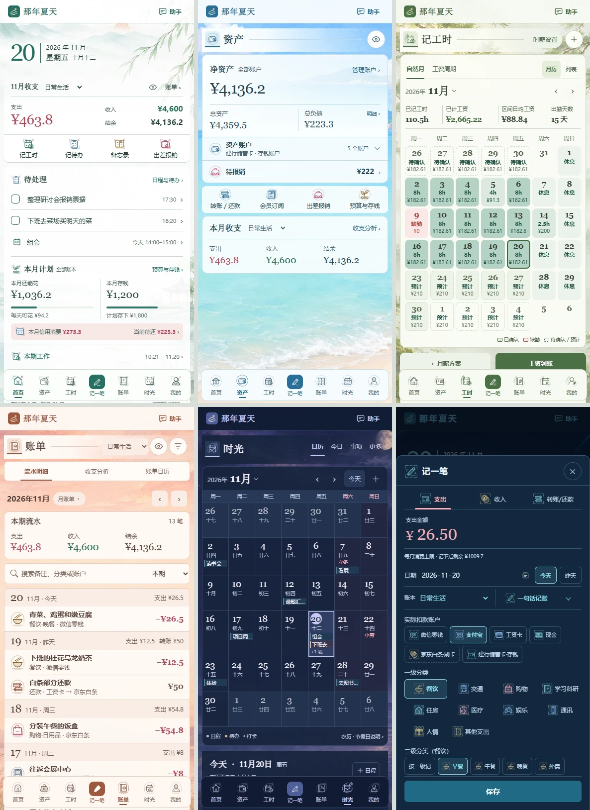

# v3.6 首页、日历与记账界面

2026-11-20。下图取自正式 APK 的页面，使用同一份人工账本、工时和日程。上排依次为首页、资产、工时，下排为流水明细、时光日历和记一笔。

## 日常操作

| 入口 | 已核对的操作 |
| --- | --- |
| 首页 | 日期进入今日日历，金额进入对应账本的月报。四个快捷入口在收支下方。以大额支出、收入和负结余复现小数拆行，改为每项占一行，在 320、740、844 像素宽度逐项检查实际文本行数。另检查切换账本和隐藏金额。 |
| 资产与账单 | 展开账户、点进余额核对、展开总负债和切换本月收支的账本。流水按天接续，有备注时优先展示备注。检查跨年搜索、筛选、分页和点开原流水。 |
| 工时与时光 | 切换自然月和工资周期、月历和列表，再回本月或本期。检查长工资金额、隐藏工资、春节和调休班，以及同一天有 13 条日程和待办时的计数和详情。 |
| 记一笔与我的 | 在金额下方更改日期，填备注、选支付渠道，再保存。回看转账手续费、信用还款、出差垫付、已停用账户的旧账。切换界面主题和配色，从应用管理展开数据或 AI 设置。 |

## 验证环境

95 项逻辑测试和 11 项成品页面浏览器用例通过。在 Edge 中遍历六套主题、五种宽度、七个主要页面，共 210 个组合，均可加载且无横向溢出。首页另检查 60 组主题、配色和明暗设置，对 3,180 处可见文字抽样，最低对比度为 4.54∶1。

在 320、390 像素宽度目视核对日历、资产、流水、设置和记账弹窗，使用缩短视口模拟键盘，检查备注输入、保存按钮和底栏。未在小米真机做覆盖安装或系统键盘验证。

Android 包名为 `com.nianxiatian.app`，版本为 3.6 / 30600。71 个包内前端文件与工作区逐字节一致。安装包为 2,788,091 字节，沿用原签名，SHA-256 为 `c627bfe49ec3f1efec02094dfa3f298d3744cf11c2c7063aaa4fcf0fc1532657`。
