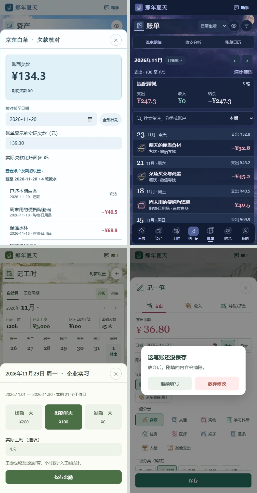

# v3.7 对账、出勤与备份

2026-11-23。下图取自正式 APK 解包页面，使用人工样例。左上核对白条截止日欠款，右上筛选 30 至 75 元的支出，左下记录半天出勤和 4.5 小时实际工时，右下从未保存的账单返回。

## 操作核对

| 入口 | 验证结果 |
| --- | --- |
| 资产与账单 | 选择 11 月 20 日作为截止日，样例白条账面欠款 134.30 元，对照实际 139.30 元，正确显示相差 5 元。用金额等于及范围筛出目标流水，单独查到转账手续费。检查跨账本、隐藏金额、范围上下限填反，以及输错期初余额时原值仍在。 |
| 工时 | 跨月工资期内按日期补出勤，整天与半天分别计薪。半天填 4.5 小时后，工时和工资分别按小时与出勤份额统计。批量补记默认不选日期，「选到昨天」排除今天，保存前遇到已确认的日期会提示重新核对。 |
| 记一笔 | 输入金额或一句话草稿后退出，选择继续填写可回到已有输入。空表单可以直接关闭。重复点保存只产生一笔账，本地保存失败时仍能在原表单重试。 |
| 备份 | 样例副本有一条日程，恢复将减少一条本地待办。取消后待办仍在，确认后按副本恢复。模拟云端断网后提示已恢复到本机，重试上传时保留恢复之后新增的备忘。 |
| 离线助手 | 在没有 AI Key 且断网的 Edge 中询问如何按金额查流水、如何按银行账单日期核对信用卡欠款，回复分别引导到对应筛选和对账入口。两次问答均未发起网络请求。 |

## 环境与结果

99 项逻辑测试和 15 项成品页面交互用例全部通过。Edge 中遍历六套主题、五种宽度（320、390、430、768、1024 像素）和七个主要页面，共 210 个组合，无横向溢出或页面资源错误。检查了六套主题的折线图、柱状图及配色切换，并目视核对上图四项操作。

Java 测试模拟下载目录写满、文件截短、等长内容损坏和系统发布文件失败。每种情况下，上一份已完成的 JSON 都能完整读回，重试成功后双份文件继续轮换。云恢复使用模拟 Android 桥接。小米真机的系统下载目录、覆盖安装和真实坚果云账号读写未实测。

包名为 `com.nianxiatian.app`，版本为 3.7 / 30700，签名证书与上一版一致。包内 71 个前端文件与工作区逐字节一致。APK 为 2,796,283 字节，SHA-256 为 `ad6dda80f914f660e8e40f854e0196d9a87b5564d16a6d006d475caf93f2570d`。
