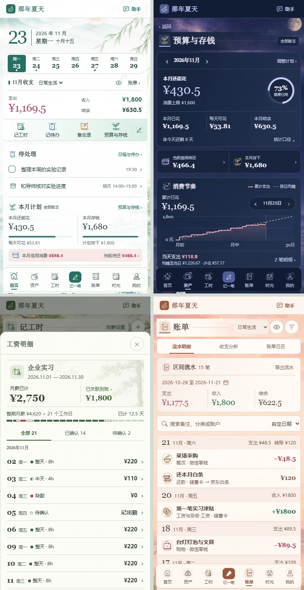

# v3.8 首页周历、预算曲线与工资明细

2026-11-23。下图使用正式 APK 的页面和一份人工样例，四幅宽度均为 390 像素。水墨首页把「预算与存钱」放进第四个常用位置。星空预算页、森林工资明细、落日流水展示同一份账在三个入口的不同用法。

| 入口 | 核对内容 |
| --- | --- |
| 首页日期与常用操作 | 点周一至周日进入对应日期，跨年周也能跳到正确年份。替换和交换四个快捷入口，分别检查保存、取消、恢复默认、重新打开及从备份恢复。核对从首页和时光分别进入专注、倒数日和打卡后的返回位置。 |
| 预算与存钱 | 样例 11 月上限 1,600 元，23 日累计已花 1,169.50 元，比当日均摊额少 57.17 元。点按、横滑及方向键都能选日期并查看当天原账。验证闰月、全账本、白条还款与手续费的区别，预记未来支出，以及未设上限和隐藏金额的显示。 |
| 工时 | 自然月看联培和家教各自贡献的工资。打开单个工资期核对整天、半天、缺勤、待确认和待上班。样例月薪 4,620 元除以 21 个工作日，半天 110 元。另核对跨月周期、分次实际到账和补记后返回原筛选。 |
| 流水 | 用自定日期跨月搜索，逐项核对含首尾、相反的日期顺序、关闭未应用、工资期快捷选择，以及在账单三个视图之间切换。造出 61 笔匹配流水，第一页显示 60 笔，导出 CSV 有完整 61 笔；其他日期、关键词不符的记录均未混入导出。 |

101 项逻辑测试和 19 项成品页面交互用例通过。Edge 另外检查六套主题、五种宽度、七个主要页面，共 210 个组合。断网且无 AI Key 时，七条测试问题都在本机得到回答，包括当天消费节奏、按工资期查账和更换首页快捷入口。

首页在六套主题、三种宽度检查排版，60 组配色与明暗组合抽样 4,020 处可见文字，最低对比度约 4.54∶1。预算图和工资明细另外检查 320 像素窄屏，核对日期选择、弹窗滚动及金额隐藏。CSV 下载在浏览器和模拟 Android 保存接口验证，未在小米真机检查系统文件选择器或覆盖安装。

正式包名为 `com.nianxiatian.app`，版本为 3.8 / 30800。沿用原发布证书，包内 71 个前端文件与工作区逐字节一致。APK 为 2,808,571 字节，SHA-256 为 `9809a635f369a85bbde45c89ffad7f5936809ddd216321411ca992ab2c49d8e0`。
